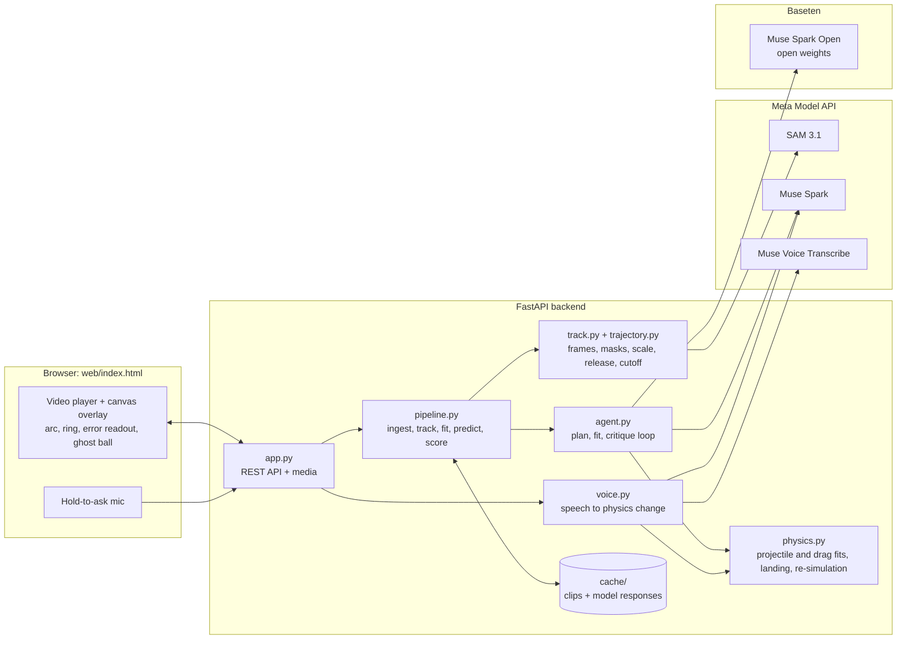

# Newton

Newton watches a video of a thrown ball and works out the physics from only the first quarter second of flight. It marks where the ball will land before it gets there. Then it answers spoken what-if questions, such as "what if this were on the Moon?", by replaying the same throw under the new physics.

**Demo video (2:11):** _[link ](https://youtu.be/OknQUSb4C2s?si=nCqFxBmWjIrat1Af)_

Built for the Meta Global AI Developer Hackathon, Indie Developer track, theme *Push the Frontier*. All code was written during the event, and every commit is dated Nov 4, 2026.

## What it does

1. Upload a side-on clip of a throw, then click the ball and the landing surface.
2. Newton tracks the ball with SAM 3.1 and **freezes the video 0.25 s after release**.
3. A predicted arc and a target ring appear where the ball will land.
4. Playback resumes, the real ball lands, and Newton shows the **error in cm**.
5. Ask a what-if by voice or text. A ghost ball replays the same launch under the new physics.

## Architecture



### Prediction pipeline

1. **Ingest.** ffmpeg extracts the frames at the capture rate and re-encodes a 30 fps player video.
2. **Track.** SAM 3.1 segments the ball in every frame of the video. Each mask gives the ball's centre and its diameter in pixels. A second SAM pass on "hand" finds the release frame.
3. **Scale.** The ball's known diameter divided by its median mask diameter gives cm per pixel, so no calibration sheet is needed.
4. **Cut off.** The track is sliced at release + 0.25 s. Everything after this point is hidden from the fitting and the models.
5. **Fit.** An agent loop runs on the sliced track (below).
6. **Predict and score.** The fitted trajectory is extended to the landing surface. The full track is used only afterwards, to measure the real landing and the error.

### Agent loop

```
Muse Spark (planner)  ──►  Python fit tools  ──►  Muse Spark Open (critic)
  reads 3 keyframes          projectile fit         checks residuals
  + tracked path,            or drag fit,           accept, or ask to drop frames,
  picks the model            optional fit of g      add drag, recheck the scale
        ▲                                                   │
        └──────────── revise (up to 4 rounds) ◄─────────────┘
```

The loop stops when the critic accepts a fit with less than 1 cm RMS error. Otherwise, after 4 rounds, the best fit is used. If any model call fails, Newton falls back to a plain projectile fit, so a prediction is always shown.

A second fit also solves for g. A result near 9.8 m/s² confirms that the scale and frame rate are right, and the UI warns when it isn't.

### What-if

Muse Voice Transcribe turns the spoken question into text. Muse Spark turns the text into a parameter change, such as g = 1.62 m/s² or speed × 2. `physics.py` re-simulates the same launch with that change, and the browser draws it as a ghost ball.

### Honesty guarantee

The prediction never sees the landing. The code enforces this, not the prompt:
- The agent's tools hold only the points up to the cutoff.
- The scale and blur filtering use only those frames.
- The keyframes sent to Muse Spark are the release, a mid-flight frame and the cutoff.

`tests/test_agent.py::test_tools_never_see_future` and `test_no_post_cutoff_data_in_prompts` check this.

### API

| Route | Purpose |
|---|---|
| `POST /api/clips` | Upload a clip and get back a clip id and its metadata |
| `POST /api/clips/{id}/run` | Start a prediction with the ball and surface clicks, optional fps, ball size and release frame |
| `GET /api/clips/{id}/status` | Progress through tracking, fitting and predicting |
| `GET /api/clips/{id}/result` | Track, predicted arc, landing, error, fit and the agent's reasoning |
| `POST /api/clips/{id}/whatif` | Ask a what-if as JSON text or a multipart audio recording |

## Meta models used

| Model | Where it runs | Role |
|---|---|---|
| **SAM 3.1** (`sam-3.1`) | Meta Model API | Tracks the ball through the video, and finds the hand for the release frame |
| **Muse Spark** (`muse-spark-1.3`) | Meta Model API | The physicist: plans the fit from keyframes and the track, explains the result, parses what-ifs |
| **Muse Spark Open** (`meta-models/muse-spark-open`, open weights) | **Baseten** | The critic: reviews every fit and sends it back for revision |
| **Muse Voice Transcribe** (`muse-voice-transcribe-1.0`) | Meta Model API | Turns the spoken what-if into text |

Every model response is cached on disk, so re-running a clip is instant and free.

## Run it

You need Python 3.11 or newer. ffmpeg is optional, because the bundled `imageio-ffmpeg` build is used if it isn't installed.

```bash
python3 -m venv .venv
.venv/bin/pip install -r requirements.txt
cp .env.example .env              # add MODEL_API_KEY and BASETEN_API_KEY
.venv/bin/uvicorn backend.app:app --port 8811
# open http://localhost:8811
```

**No API keys?** `NEWTON_OFFLINE=1` replaces every model with a local stand-in (colour tracking and canned replies) and runs the whole flow on a synthetic throw:

```bash
.venv/bin/python -c "from tests.fixtures.synth import make_synthetic_clip as m; m('cache/synth.mp4')"
NEWTON_OFFLINE=1 .venv/bin/uvicorn backend.app:app --port 8811
```

**Tests:** run `.venv/bin/pytest`. There are 77 tests covering physics, tracking, the API clients, the agent loop, what-ifs and end-to-end runs.

## Results

| Clip | Frames Newton saw | Gravity check | Landing error |
|---|---|---|---|
| Real hand toss, 30 fps ([Open Source Physics Tracker](https://opensourcephysics.github.io/tracker-website/) sample `BallTossOut.mp4`) | 8 (frames 10–18) | 9.85 m/s² | **0.7 cm** |
| Rendered throw, 240 fps, true landing known | 60 (frames 16–76) | 9.52 m/s² | **3.7 cm** |

On the real toss, the scale taken from the ball's size (0.2515 cm/px) is within 1% of the meter stick in the shot (0.2500 cm/px). The critic accepted the first fit at 0.07 cm RMS, after the blur filter dropped one frame where the ball passes behind the stick.

On the rendered throw, SAM's masks come out about 3% wide, which skews the scale. Its release frame was also entered by hand.

## Credits

- Sample footage: Open Source Physics Tracker.
- Demo narration: Kokoro text-to-speech.
